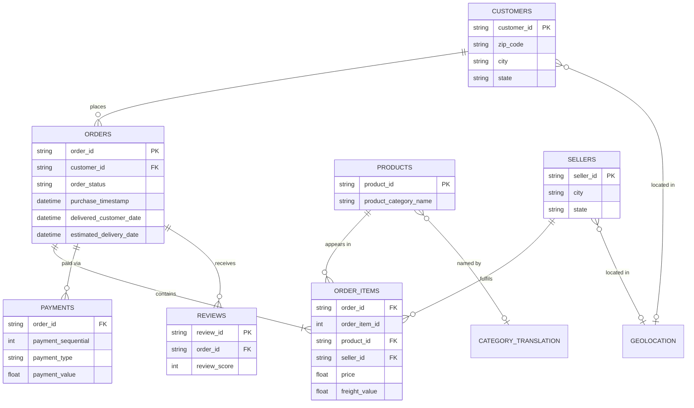
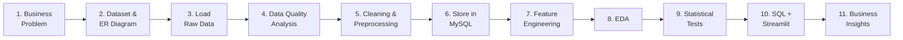

<div align="center">

# 🛒 Cart2Insights: Decoding E-Commerce Performance

**An end-to-end e-commerce analytics solution: Python · Pandas · MySQL · Statistics · Streamlit**


*From raw CSVs to a cleaned SQL warehouse, statistical tests, and an interactive dashboard that turns data into decisions.*

[Live Demo](#-live-demo) · [Key Insights](#-business-insights--recommendations) · [Quick Start](#-getting-started) · [Dashboard](#-streamlit-dashboard)

</div>

---

## 📑 Table of Contents

1. [Overview](#-overview)
2. [Business Objectives](#-business-objectives)
3. [Highlights](#-highlights)
4. [Tech Stack](#-tech-stack)
5. [Dataset & ER Diagram](#-dataset--er-diagram)
6. [Project Workflow](#-project-workflow)
7. [Repository Structure](#-repository-structure)
8. [Data Quality & Cleaning](#-data-quality--cleaning)
9. [Feature Engineering](#-feature-engineering)
10. [SQL Analysis](#-sql-analysis)
11. [Exploratory Data Analysis](#-exploratory-data-analysis)
12. [Statistical Analysis](#-statistical-analysis)
13. [Streamlit Dashboard](#-streamlit-dashboard)
14. [Business Insights & Recommendations](#-business-insights--recommendations)
15. [Getting Started](#-getting-started)
16. [Configuration & Security](#-configuration--security)
17. [Deliverables Checklist](#-deliverables-checklist)
18. [Challenges & Learnings](#-challenges--learnings)
19. [Future Improvements](#-future-improvements)
20. [Author & Acknowledgements](#-author--acknowledgements)

---

## 🔎 Overview

An e-commerce platform generates a huge volume of data across **orders, products, sellers, payments, deliveries, and customer reviews**. Because that data is spread across multiple related tables, it is hard to see overall business performance or customer behaviour from the raw files alone.

**Cart2Insights** solves this by building a complete analytics pipeline:

> **Raw CSVs → Pandas cleaning → MySQL database → Feature engineering → EDA → Hypothesis testing → Streamlit dashboard → Business recommendations**

The result is a single, reproducible solution that answers questions about **sales, customers, products, sellers, payments, delivery performance, and customer satisfaction**.

---

## 🎯 Business Objectives

| Use Case | Question the project answers |
|---|---|
| **Performance Monitoring** | How is the business doing overall: revenue, orders, customers, sellers? |
| **Customer Behaviour & Segmentation** | Who are our top customers? How many are repeat buyers vs. new? |
| **Sales & Revenue Optimization** | Which months, categories, and regions drive revenue? |
| **Product & Seller Analysis** | Which sellers and categories perform best, and which lag? |
| **Delivery & Operations** | How long do deliveries take, and how often are they late? |
| **Customer Experience** | Do delivery delays hurt review scores? |
| **Data-Driven Decisions** | What should the business do next, based on evidence? |

---

## ✨ Highlights

- 🧹 **Full data-quality audit**: missing values, duplicates, dtypes, invalid values, outliers, and primary-key uniqueness checks across all 9 tables.
- 🗄️ **Relational SQL warehouse** in MySQL with primary and foreign key constraints, loaded via SQLAlchemy.
- 🧠 **Business feature engineering**: order value, delivery days, delivery delay, customer lifetime spend, seller revenue, repeat-customer flag, and more.
- 📊 **Complete EDA**: univariate, bivariate, multivariate, trend, correlation, and distribution analysis.
- 🧪 **Three hypothesis tests** (T-Test, ANOVA, Chi-Square) with assumption checks and plain-English business interpretation.
- 🧮 **Advanced SQL**: joins, subqueries, CTEs, window functions, and aggregations powering the analysis.
- 🖥️ **Interactive Streamlit dashboard** with 6 sections, connected live to the SQL database.
- 🔐 **No hardcoded credentials**: configuration lives in environment variables.

---

## 🧰 Tech Stack

| Layer | Tools |
|---|---|
| Language | Python 3.10+ |
| Data Wrangling | Pandas, NumPy |
| Database | MySQL, SQLAlchemy, PyMySQL |
| Visualization | Matplotlib, Seaborn, Plotly |
| Statistics | SciPy, Statsmodels |
| Dashboard | Streamlit |
| Workflow | Jupyter Notebooks, Git & GitHub |

---

## 🗂️ Dataset & ER Diagram

The **Cart2Insights dataset** consists of **9 related tables** covering the full order lifecycle. Download the data from **[Cart2Insights Dataset](<!-- TODO: paste dataset link -->)** and place the CSV files in `data/raw/`.

> 📌 **Large files are not committed to this repo** (see [Configuration & Security](#-configuration--security)).

### Data Dictionary

> ✏️ *Update table and column names to match your CSV files exactly.*

| # | Table | Description | Primary Key | Foreign Keys |
|---|---|---|---|---|
| 1 | `customers` | Customer identity and location | `customer_id` | n/a |
| 2 | `orders` | Order header: status and timestamps | `order_id` | `customer_id` |
| 3 | `order_items` | Line items: product, seller, price, freight | `order_id` + `order_item_id` | `order_id`, `product_id`, `seller_id` |
| 4 | `payments` | Payment method, installments, value | `order_id` + `payment_sequential` | `order_id` |
| 5 | `reviews` | Review score and comments | `review_id` | `order_id` |
| 6 | `products` | Product attributes and category | `product_id` | n/a |
| 7 | `sellers` | Seller identity and location | `seller_id` | n/a |
| 8 | `geolocation` | Zip-code to coordinates mapping | n/a | n/a |
| 9 | `category_translation` | Category name translation | `product_category_name` | n/a |

### Entity-Relationship Diagram



> 🖼️ A full-resolution ER diagram is available in [`docs/er_diagram.png`](docs/er_diagram.png).

---

## 🔄 Project Workflow



Each stage maps to one notebook, so the entire analysis can be reproduced top to bottom.

---

## 📁 Repository Structure

```
Cart2Insights/
│
├── data/
│   ├── raw/                          # Original CSVs (git-ignored)
│   └── cleaned/                      # Cleaned CSVs (git-ignored)
│
├── notebooks/
│   ├── 01_data_understanding.ipynb   # Load data, shapes, dtypes, data dictionary
│   ├── 02_data_quality_analysis.ipynb# Missing values, duplicates, outliers, PK checks
│   ├── 03_data_cleaning.ipynb        # Cleaning & preprocessing
│   ├── 04_sql_analysis.ipynb         # DB load + SQL business queries
│   ├── 05_feature_engineering.ipynb  # Business features
│   ├── 06_eda.ipynb                  # Exploratory data analysis
│   └── 07_statistical_analysis.ipynb # T-Test, ANOVA, Chi-Square
│
├── streamlit/
│   ├── app.py                        # Dashboard entry point
│   ├── database.py                   # SQLAlchemy engine / connection
│   ├── queries.py                    # SQL queries used by the dashboard
│   └── utils.py                      # Helpers: KPI cards, chart builders, formatting
│
├── docs/                             # ER diagram, screenshots
├── .env.example                      # Template for DB credentials (safe to commit)
├── .gitignore
├── requirements.txt
└── README.md
```

---

## 🧹 Data Quality & Cleaning

### Quality checks performed

| Check | Method |
|---|---|
| Missing values | `df.isna().sum()` and missingness percentage per column |
| Duplicates | Full-row and key-based duplicate detection |
| Incorrect data types | Dtype audit, with dates parsed to `datetime` |
| Inconsistent / invalid values | Category value counts, negative prices, impossible date orders |
| Outliers | IQR and boxplot inspection on price, freight, delivery time |
| Primary-key uniqueness | `df[pk].is_unique` for every table |

### Cleaning actions

> ✏️ *Replace the placeholders below with your actual findings and decisions.*

| Table | Issue found | Action taken | Rows affected |
|---|---|---|---|
| `orders` | _e.g. missing delivery dates_ | _e.g. kept for non-delivered statuses; excluded from delivery analysis_ | _TBD_ |
| `products` | _e.g. missing category_ | _e.g. filled with `unknown`_ | _TBD_ |
| `reviews` | _e.g. duplicate review IDs_ | _e.g. dropped duplicates_ | _TBD_ |
| _…_ | | | |

**Standard steps applied:** handled missing values · removed duplicates · corrected data types · formatted date/time columns · standardised categorical values · handled invalid records · renamed columns for consistency.

---

## 🧠 Feature Engineering

| Feature | Definition | Business Use |
|---|---|---|
| `total_order_value` | Sum of item price + freight per order | Revenue and AOV analysis |
| `delivery_days` | Delivered date − purchase date (days) | Operational efficiency |
| `delivery_delay` | Delivered date − estimated date (days; positive = late) | Service-level tracking |
| `is_delayed` | `delivery_delay > 0` | On-time vs. delayed segmentation |
| `customer_order_count` | Number of orders per customer | Loyalty analysis |
| `customer_total_spending` | Total spend per customer | Customer value / top customers |
| `avg_order_value` | `customer_total_spending / customer_order_count` | Basket-size insights |
| `seller_revenue` | Total revenue per seller | Seller ranking |
| `seller_order_count` | Number of orders per seller | Seller activity |
| `is_repeat_customer` | `customer_order_count > 1` | Repeat vs. new analysis |

> 💡 **Tip:** compute repeat-customer metrics on the *persistent* customer identifier, not a per-order ID, or every customer will appear to have a single order. Delivery features only apply to orders that were actually delivered.

---

## 🗄️ SQL Analysis

Cleaned data is loaded into **MySQL** with the schema defined by the ER diagram, including **primary and foreign key constraints**, and verified after loading (row counts match the cleaned CSVs).

**SQL concepts used:** `SELECT / WHERE / ORDER BY` · `GROUP BY / HAVING` · Joins · Subqueries · CTEs · Window Functions · Aggregations

### Example 1: Monthly revenue with month-over-month growth (CTE + window function)

```sql
WITH monthly_revenue AS (
    SELECT
        DATE_FORMAT(o.order_purchase_timestamp, '%Y-%m') AS month,
        SUM(oi.price + oi.freight_value)                 AS revenue
    FROM orders o
    JOIN order_items oi ON oi.order_id = o.order_id
    WHERE o.order_status = 'delivered'
    GROUP BY month
)
SELECT
    month,
    ROUND(revenue, 2) AS revenue,
    ROUND(
        100 * (revenue - LAG(revenue) OVER (ORDER BY month))
            / LAG(revenue) OVER (ORDER BY month), 2
    ) AS mom_growth_pct
FROM monthly_revenue
ORDER BY month;
```

### Example 2: Top 3 sellers per state (window function)

```sql
WITH seller_revenue AS (
    SELECT s.seller_id, s.seller_state, SUM(oi.price) AS revenue
    FROM order_items oi
    JOIN sellers s ON s.seller_id = oi.seller_id
    GROUP BY s.seller_id, s.seller_state
)
SELECT *
FROM (
    SELECT *,
           RANK() OVER (PARTITION BY seller_state ORDER BY revenue DESC) AS state_rank
    FROM seller_revenue
) ranked
WHERE state_rank <= 3;
```

> All queries used by the dashboard live in [`streamlit/queries.py`](streamlit/queries.py); exploratory versions are in `notebooks/04_sql_analysis.ipynb`.

---

## 📊 Exploratory Data Analysis

| Type | What was explored |
|---|---|
| **Univariate** | Distributions of order value, freight, delivery days, review scores |
| **Bivariate** | Delivery delay vs. review score · category vs. revenue · payment type vs. order value |
| **Multivariate** | Category × region × review score · pairplots and heatmaps |
| **Trend** | Monthly orders and revenue over time, seasonality |
| **Correlation** | Correlation matrix across numeric business features |
| **Distribution** | Skewness, outliers, and spread of key metrics |

📸 *Add your best 2–3 EDA charts here (store them in `docs/`).*

```markdown


```

---

## 🧪 Statistical Analysis

Every test follows the same disciplined flow:

> **Define hypothesis → Select test → Check assumptions → Calculate p-value → Make statistical decision → Translate into business insight**

Significance level: **α = 0.05**

### 1️⃣ T-Test: Delivery Delay & Customer Satisfaction

| | |
|---|---|
| **Question** | Do delayed orders receive significantly lower review scores than on-time orders? |
| **H₀** | Mean review score (delayed) = mean review score (on-time) |
| **H₁** | Mean review score (delayed) < mean review score (on-time) |
| **Method** | Independent two-sample T-Test (Welch's variant if variances differ) |
| **Assumptions** | Independence · approximate normality (large n) · equal variance (Levene's test) |
| **Robustness check** | Mann-Whitney U, since review scores are ordinal · effect size (Cohen's d) |
| **Result** | _t = TBD, p = TBD → Reject / Fail to reject H₀_ |
| **Business insight** | _TBD_ |

### 2️⃣ One-Way ANOVA: Product Category & Spending

| | |
|---|---|
| **Question** | Does average order value differ significantly across product categories? |
| **H₀** | All category means are equal |
| **H₁** | At least one category mean differs |
| **Method** | One-Way ANOVA |
| **Assumptions** | Independence · normality of residuals · homogeneity of variance (Levene's test) |
| **Follow-up** | Tukey HSD post-hoc to see *which* categories differ · Kruskal-Wallis if assumptions fail |
| **Result** | _F = TBD, p = TBD → Reject / Fail to reject H₀_ |
| **Business insight** | _TBD_ |

### 3️⃣ Chi-Square: Payment Method & Order Status

| | |
|---|---|
| **Question** | Is there a significant association between payment method and order status? |
| **H₀** | Payment method and order status are independent |
| **H₁** | Payment method and order status are associated |
| **Method** | Chi-Square Test of Independence |
| **Assumptions** | Independent observations · expected frequency ≥ 5 in most cells (rare statuses may need grouping) |
| **Effect size** | Cramér's V |
| **Result** | _χ² = TBD, p = TBD, dof = TBD → Reject / Fail to reject H₀_ |
| **Business insight** | _TBD_ |

> ⚠️ With very large samples, even tiny differences become "statistically significant". Effect sizes are reported alongside p-values to separate *significant* from *meaningful*.

---

## 🖥️ Streamlit Dashboard

An interactive dashboard connected **live to the MySQL database**, powered by the SQL queries above.

| Section | Contents |
|---|---|
| **1. Business Overview** | Total revenue · orders · customers · sellers · avg order value · avg review score |
| **2. Sales Analysis** | Monthly revenue trend · revenue by category · top-selling products · sales by location |
| **3. Customer Analysis** | Customer distribution · spending · repeat vs. new · top customers |
| **4. Seller & Product Analysis** | Top sellers · seller revenue · product/category performance · seller ratings |
| **5. Delivery Analysis** | Avg delivery time · on-time vs. delayed · delivery by location · delay vs. review score |
| **6. Customer Experience** | Review score distribution · reviews by category · rating vs. delivery performance |

### 🚀 Live Demo

- **Deployed app:** <!-- TODO: add Streamlit Cloud link, or remove this line -->
- **Demo video:** <!-- TODO: add link -->

### Screenshots

> 📸 *Replace with your own screenshots (store in `docs/`).*

| Business Overview | Delivery Analysis |
|---|---|
|  |  |

---

## 💡 Business Insights & Recommendations

Every finding follows **Observation → Interpretation → Business Impact**.

> ✏️ *Fill this table with your actual results. Each row should cite a number from your analysis.*

| # | Observation | Interpretation | Business Impact / Recommendation |
|---|---|---|---|
| 1 | _e.g. Delayed orders score X points lower on average (p < 0.05)_ | _Delivery experience drives satisfaction_ | _Prioritise logistics SLAs; flag at-risk orders early_ |
| 2 | _e.g. Top N categories generate X% of revenue_ | _Revenue is concentrated_ | _Focus marketing and inventory on high-yield categories_ |
| 3 | _e.g. Only X% of customers place a second order_ | _Retention is weak_ | _Launch loyalty and re-engagement campaigns_ |
| 4 | _e.g. Revenue peaks in Month Y_ | _Seasonal demand_ | _Plan stock, staffing, and promotions ahead of peaks_ |
| 5 | _e.g. A few sellers account for X% of revenue_ | _Seller concentration risk_ | _Onboard and support mid-tier sellers_ |

---

## ⚙️ Getting Started

### Prerequisites

- Python **3.10+**
- MySQL **8.0+** running locally or remotely
- Git

### 1. Clone the repository

```bash
git clone https://github.com/<your-username>/Cart2Insights.git
cd Cart2Insights
```

### 2. Create a virtual environment & install dependencies

```bash
python -m venv venv
source venv/bin/activate        # Windows: venv\Scripts\activate
pip install -r requirements.txt
```

### 3. Add the dataset

Download the **Cart2Insights dataset** and place all CSV files in `data/raw/`.

### 4. Configure the database

```bash
cp .env.example .env            # Windows: copy .env.example .env
```

Edit `.env` with your MySQL credentials (see [Configuration & Security](#-configuration--security)), then create the database:

```sql
CREATE DATABASE cart2insights;
```

### 5. Run the notebooks in order

```
01_data_understanding  →  02_data_quality_analysis  →  03_data_cleaning
→  04_sql_analysis  →  05_feature_engineering  →  06_eda  →  07_statistical_analysis
```

### 6. Launch the dashboard

```bash
streamlit run streamlit/app.py
```

Open **http://localhost:8501** in your browser.

---

## 🔐 Configuration & Security

Database credentials are **never hardcoded**. They are read from environment variables.

**`.env.example`** (committed)

```env
DB_HOST=localhost
DB_PORT=3306
DB_USER=your_username
DB_PASSWORD=your_password
DB_NAME=cart2insights
```

**`streamlit/database.py`**

```python
import os
from dotenv import load_dotenv
from sqlalchemy import create_engine
from sqlalchemy.engine import URL

load_dotenv()

def get_engine():
    url = URL.create(
        drivername="mysql+pymysql",
        username=os.getenv("DB_USER"),
        password=os.getenv("DB_PASSWORD"),
        host=os.getenv("DB_HOST", "localhost"),
        port=int(os.getenv("DB_PORT", 3306)),
        database=os.getenv("DB_NAME"),
    )
    return create_engine(url, pool_pre_ping=True)
```

**`.gitignore`** (minimum)

```gitignore
.env
data/raw/
data/cleaned/
venv/
__pycache__/
.ipynb_checkpoints/
*.sqlite
```

> 🚫 **Never commit** credentials, passwords, `.env` files, or large datasets.

---

## ✅ Deliverables Checklist

- [x] **Source Code**: notebooks for cleaning, feature engineering, EDA, and statistical analysis
- [x] **SQL Integration**: Python–MySQL connection and analysis queries
- [x] **Streamlit Application**: interactive dashboard with visualisations and insights
- [x] **Project Documentation**: this README (objective, approach, methodology, findings)
- [x] **Business Insights & Recommendations**: see [above](#-business-insights--recommendations)
- [ ] **Final Presentation**: demo of the project and dashboard

---

## 📚 Challenges & Learnings

> ✏️ *Make this personal. Reviewers value honest reflection.*

- **Challenge:** _e.g. joining tables with one-to-many relationships inflated revenue totals._ → **Fix:** _aggregate to order level before joining._
- **Challenge:** _e.g. highly skewed order values._ → **Fix:** _used log transforms and non-parametric tests as a robustness check._
- **Learning:** _e.g. the value of validating row counts after every join and every database load._

---

## 🔭 Future Improvements

- Customer segmentation with **RFM analysis** and clustering
- **Predictive model** for late-delivery risk or low review scores
- **Sentiment analysis** on review text
- Automated **ETL pipeline** with scheduled refresh
- **Docker** setup for one-command reproducibility
- Deploy the dashboard on **Streamlit Community Cloud**

---

## 👤 Author & Acknowledgements

**<Your Name>**
🔗 [LinkedIn](https://linkedin.com/in/<your-profile>) · 💻 [GitHub](https://github.com/<your-username>) · ✉️ <your-email>

Built as a capstone project for the **GUVI × HCL** programme.
Thanks to the mentors and reviewers for their guidance and feedback.

---

<div align="center">

⭐ If you found this project useful, consider giving it a star!

</div>
